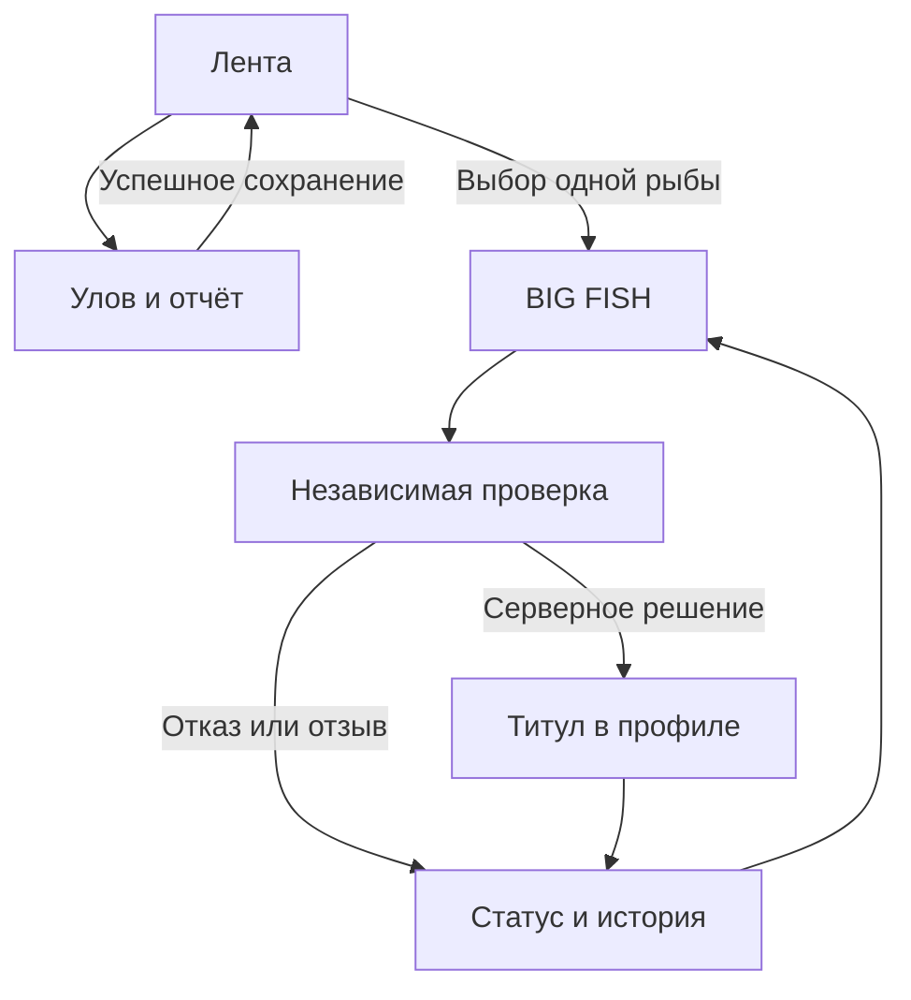

# Единая карта экранов и переходов ZAPRUDA

Дата: 05.11.2026. Основа #93 `9c7fe6e`; канонические решения #111 `a6ded87`, включая D22. Зарегистрированный экран не равен работающему backend или пройденной приёмке.

Машиночитаемая карта: [ZAPRUDA_ROUTE_GRAPH.json](ZAPRUDA_ROUTE_GRAPH.json). Проверка существования маршрутов и буквальных внутренних ссылок: `node scripts/check-route-graph.mjs`.

Отчёт, заявка, проверенный улов и действующий титул — отдельные состояния. Передача из отчёта переносит только вид, вес и длину одной рыбы. Время, разрешённый SPOT и приватное доказательство заполняются отдельно. Выдача и отзыв — существующие серверные функции, а не клиентские вычисления.

| Переход | Реальное действие / условие |
|---|---|
| `/reports/new` → `/` | successful actual report/catch/photo persistence; draft retained on failure |
| `/` → `/big-fish` | explicit selection of one owned report fish; optional short-lived handoff, no automatic submission |
| `/big-fish` → `/big-fish#my-catches` | existing private submit + independent server review; genuine positive acceptance BLOCKED |
| `/big-fish#my-catches` → `/profile#verified-titles` | owner-only current title_holders/history; pending fish or XP is not KING |
| `/communities` → `/on-spot` | honest local-zone entry; OSP-01…09 not accepted |
| `/on-spot` → `/chat` | explicit general-chat fallback, not moderated zone membership |

Нижняя навигация остаётся: **Лента / Комьюнити / + / Выезды / Чат**. Профиль доступен из хедера. SPOT и остальные модули — из существующего меню; BIG FISH дополнительно из SPOT и результата отчёта. ON SPOT+ — из Сообществ и SPOT. Административные ссылки и серверные права не выдаются обычному пользователю.

| Зарегистрированный маршрут | Файл |
|---|---|
| `/admin/feedback` | `src/routes/admin.feedback.tsx` |
| `/admin/` | `src/routes/admin.index.tsx` |
| `/admin/operations` | `src/routes/admin.operations.tsx` |
| `/admin` | `src/routes/admin.tsx` |
| `/analytics` | `src/routes/analytics.tsx` |
| `/assistant` | `src/routes/assistant.tsx` |
| `/atlas` | `src/routes/atlas.tsx` |
| `/auth` | `src/routes/auth.tsx` |
| `/big-fish` | `src/routes/big-fish.tsx` |
| `/chat` | `src/routes/chat.tsx` |
| `/communities` | `src/routes/communities.tsx` |
| `/competitions` | `src/routes/competitions.tsx` |
| `/feedback` | `src/routes/feedback.tsx` |
| `/finance` | `src/routes/finance.tsx` |
| `/guides` | `src/routes/guides.tsx` |
| `/` | `src/routes/index.tsx` |
| `/market` | `src/routes/market.tsx` |
| `/messages` | `src/routes/messages.tsx` |
| `/moderation` | `src/routes/moderation.tsx` |
| `/on-spot` | `src/routes/on-spot.tsx` |
| `/partners` | `src/routes/partners.tsx` |
| `/profile` | `src/routes/profile.tsx` |
| `/reports/new` | `src/routes/reports.new.tsx` |
| `/settings` | `src/routes/settings.tsx` |
| `/spearfishing` | `src/routes/spearfishing.tsx` |
| `/specializations` | `src/routes/specializations.tsx` |
| `/street` | `src/routes/street.tsx` |
| `/welcome` | `src/routes/welcome.tsx` |

## Не скрытые незавершённые зависимости

- `/on-spot` — вход и безопасный fallback. Нет backend moderated zones/membership/presence/invites; все OSP-01…09 сохраняют обязательный P0. Страновые чаты не заменяют локальные зоны.
- `/big-fish` переиспользует действующий STREET/UL private-evidence API. Существование семи названий KING не доказывает полную server acceptance CARP/ICE/BOAT.
- Настоящая положительная KING-приёмка заблокирована: в STAGING нет назначенного независимого модератора, одобренного законного SPOT и подлинного evidence. Роли и публичные фикстуры не создаются.
- Документационные и кодовые PR сверяются по точному SHA; инвентаризация веток не разрешает их удаление или merge в main.

Фактические PASS/FAIL/BLOCKED и SHA дополняются в отчёте архитектурной консолидации после проверки.
